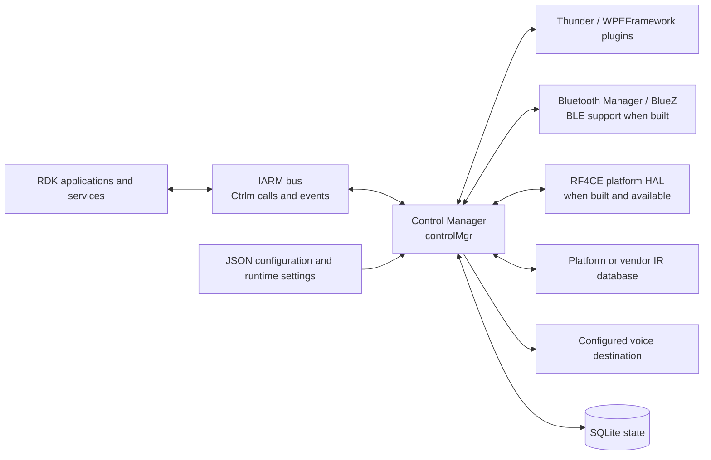
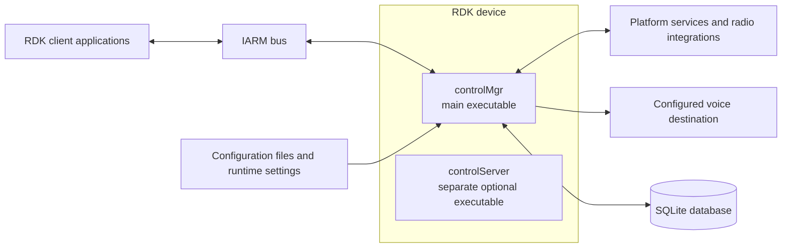
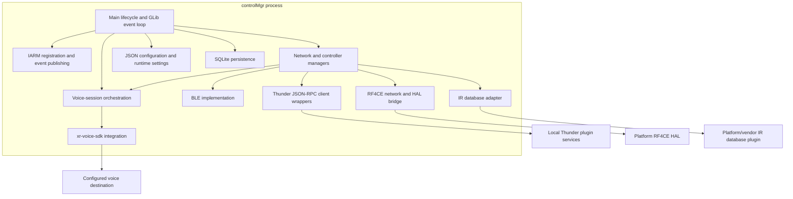

# Control Manager Architecture and Interfaces

Control Manager (`controlMgr`) is a device-side RDK service that coordinates remote-control networks, controller state, voice-session routing, configuration, and related device-control integrations. Its main process is built as the `controlMgr` executable ([CMake target](../CMakeLists.txt), [startup and lifecycle](../src/ctrlm_main.cpp)).

The daemon's primary local client contract is the versioned IARM bus API. Thunder integrations in this repository are JSON-RPC clients of other local platform plugins; they are not the daemon's inbound API. BLE, RF4CE, voice transports, and other integrations depend on build options and target configuration.

## Architecture

The following views describe the same system at context, deployment/container, and component levels. Mermaid flowcharts are used to match the format already present in the [project README](../README.md).

### System context



RDK clients communicate with `controlMgr` through IARM calls and events. The other edges are dependencies used by the daemon: Thunder calls are outbound JSON-RPC, RF4CE is a platform HAL, and voice destinations are selected by configured routes. The diagram is a capability view, not a guarantee that every integration is enabled in every product ([build options](../CMakeLists.txt), [runtime defaults](../src/ctrlm_config_default.json)).

### Containers and deployment units



`controlMgr` is the main executable and runs its lifecycle and event loop in one device process. `controlServer` is a distinct executable included only when `BUILD_CTRLM_SERVER` is enabled; that option defaults to OFF in CMake. It is shown as a separate deployment unit; the diagram makes no claim about a direct communication path between the two executables. Neither source folder names nor linked libraries are separate containers. The exact target image, process supervision, and product feature selection are outside the guarantees of this repository ([root CMake](../CMakeLists.txt), [server target](../src/server/CMakeLists.txt)).

### Main-process components



The main process coordinates network/controller state and exposes IARM handlers. BLE and RF4CE implementations are compile-time gated; RF4CE also depends on a runtime-loadable platform HAL. The IR database adapter loads a platform/vendor implementation when available. Thunder wrappers call local platform plugins, while the voice manager uses `xr-voice-sdk` to route sessions to configured destinations ([source composition](../src/CMakeLists.txt), [main IARM handlers](../src/ctrlm_main_iarm.cpp), [IR database adapter](../src/irdb/ctrlm_irdb_interface.cpp)).

## Data models and persistence

### Configuration

The checked-in [default configuration](../src/ctrlm_config_default.json) is a JSON object with feature sections including `ctrlm_global`, `network_rf4ce`, `network_ble`, `network_ip`, `voice`, and `device_update`. Configuration readers are implemented under [`src/config/`](../src/config/). Relevant examples include:

- `ctrlm_global.db_path` selects the SQLite database file; the checked-in default is `/opt/ctrlm.sql`.
- `network_ble.options`, `network_ble.timeouts`, and `network_ble.models` control BLE-specific options and supported model descriptions. The default model list is empty.
- `voice` contains route URLs such as `url_src_ptt`, `url_src_ff`, and `url_src_mic_tap`; these defaults are empty, so products supply routes when voice destinations are required.

The configuration describes runtime settings; it is not itself a database schema. Build options and product overrides can change the available features and values.

### Runtime and stored state

The public IPC types identify networks and controllers, and network/controller managers own their runtime state ([IPC types](../include/ctrlm_ipc.h), [network manager](../src/ctrlm_network.cpp), [controller manager](../src/ctrlm_controller.cpp)). SQLite stores selected global, voice, IR, network, and controller attributes. The implementation creates tables using `key TEXT PRIMARY KEY, value TEXT` columns and uses dynamically named per-network and per-controller table families; typed helpers also support integer and blob values ([database implementation](../src/database/ctrlm_database.cpp), [database value types](../src/database/ctrlm_db_types.h)).

This is a key/value persistence layout, not a normalized relational model. A controller list associates controller identifiers with a network, while controller-specific records are stored separately. Which network tables exist depends on the networks initialized at runtime. Do not infer that every runtime value is persisted.

## APIs and integrations

### Inbound IARM APIs

`controlMgr` initializes on the IARM bus named `Ctrlm` and registers calls and broadcasts events there ([bus initialization](../src/ctrlm_main.cpp), [main call registration](../src/ctrlm_main_iarm.cpp)). Public calls use C structures declared in the API headers; API revision fields are checked by handlers.

| Contract | Revision | Examples |
| --- | ---: | --- |
| Main Control Manager API ([header](../include/ctrlm_ipc.h)) | 16 | `Main_StatusGet`, network/status queries, audio-capture calls |
| Voice API ([header](../include/ctrlm_ipc_voice.h)) | 9 | `Voice_Status`, `Voice_ConfigureVoice`, `Voice_SessionRequest`, `Voice_SessionTerminate` |
| Remote-control (RCU) API ([header](../include/ctrlm_ipc_rcu.h)) | 13 | `Rcu_ControllerStatus`, RF4CE polling action; controller and key events |

The daemon publishes events for key input, controller status/control, battery/reboot state, firmware progress, and voice sessions. Current voice session/stream notifications use JSON payload events; some older event identifiers in the public header are explicitly marked deprecated. Treat the installed/public headers as the compatibility contract and match the revision required by each API family ([event definitions](../include/ctrlm_ipc.h), [voice call registration](../src/voice/ipc/ctrlm_voice_ipc_iarm_thunder.cpp), [RCU event publication](../src/ctrlm_rcu_iarm.cpp)).

The reviewed main executable does not define an inbound REST endpoint. In particular, the Thunder wrappers below are client integrations, not Thunder APIs served by `controlMgr`.

### Outbound integrations

- **Thunder / WPEFramework**: JSON-RPC client wrappers interact with local services such as PowerManager, DeviceInfo, SystemAudioPlayer, AVInput, HDMI CEC, and DisplaySettings. For example, the PowerManager wrapper calls methods including `getPowerState`; service availability and API definitions belong to the platform plugin ([Thunder clients](../src/thunder/)).
- **BLE**: when built with BLE support, Control Manager uses Bluetooth Manager/BlueZ and the repository's D-Bus/BlueZ implementation ([BLE sources](../src/ble/), [BLE HAL interface](../include/ctrlm_hal_ble.h)).
- **RF4CE**: when built and available, the network uses a platform-provided HAL interface; the main process loads the implementation dynamically ([RF4CE HAL contract](../include/ctrlm_hal_rf4ce.h), [RF4CE network](../src/rf4ce/)).
- **IR database**: an adapter loads a platform/vendor implementation when available and also has a repository stub ([IR database adapter](../src/irdb/ctrlm_irdb_interface.cpp)).
- **Voice destinations**: the voice manager delegates transport/session work to `xr-voice-sdk`; destination routes come from configuration. HTTP and SDT endpoint sources are added by the `XRSR_HTTP` and `XRSR_SDT` CMake options, but routing to them also requires the `SUPPORT_VOICE_DEST_HTTP` (not set by this repository's CMake) and `SUPPORT_VOICE_DEST_ALSA` (set by `ENABLE_AVS_WITH_SDT`) compile definitions. No fixed remote host or speech-service schema is established here ([voice sources](../src/voice/), [build options](../CMakeLists.txt)).

These integrations are dependencies called or loaded by Control Manager; they are not additional inbound public APIs of the daemon.

## Building

Control Manager is built with CMake (minimum 3.16) inside an RDK-compatible Linux environment, normally a Yocto/BitBake build or the matching SDK. It links platform libraries such as IARM, DeviceSettings, RFC, `xr-voice-sdk`, GLib/GIO, SQLite, Jansson, D-Bus, nopoll, OpenSSL, and systemd, so a generic desktop Linux install cannot build it as-is ([root CMake](../CMakeLists.txt)).

### Build inputs

The build generates code and configuration, so these tools and CMake variables are required in addition to the compiler toolchain:

| Input | Purpose |
| --- | --- |
| `python3`, `gperf` | Run the JSON combine/header scripts and generate the voice request-type lookup ([root CMake](../CMakeLists.txt)) |
| `CTRLM_UTILS_JSON_COMBINE`, `CTRLM_UTILS_JSON_TO_HEADER` | Paths to the JSON combine and JSON-to-header scripts (provided by `xr-voice-sdk`) |
| `CTRLM_CONFIG_JSON_CPC`, `CTRLM_CONFIG_JSON_CPC_SUB`, `CTRLM_CONFIG_JSON_CPC_ADD`, `CTRLM_CONFIG_JSON_MAIN_SUB`, `CTRLM_CONFIG_JSON_MAIN_ADD` | JSON overlays merged with [`src/ctrlm_config_default.json`](../src/ctrlm_config_default.json) to produce the build's `ctrlm_config.json` and compiled-in defaults |
| `CMAKE_PROJECT_VERSION` | Version string embedded in the generated `ctrlm_version_build.h` |

The generated `ctrlm_config.json` is installed to `${CMAKE_INSTALL_SYSCONFDIR}`, and `controlMgr` is installed to `bin`.

### Feature options

| Option | Default | Effect |
| --- | --- | --- |
| `BLE_ENABLED` | ON | BLE network and Bluetooth Manager/BlueZ integration |
| `RF4CE_ENABLED` | ON | RF4CE network sources |
| `THUNDER` | ON | Thunder JSON-RPC client wrappers and Thunder-dependent IPC |
| `THUNDER_SECURITY` | OFF | Thunder security token support (requires `THUNDER`) |
| `AUTH_ENABLED` | OFF | Authentication/SAT support (Thunder builds); WSS for `controlServer` |
| `TELEMETRY_SUPPORT` | OFF | Telemetry reporting |
| `BREAKPAD` | OFF | Breakpad crash minidumps |
| `XRSR_HTTP`, `XRSR_SDT` | OFF | Compile the HTTP and SDT voice endpoint sources (route selection also needs `SUPPORT_VOICE_DEST_HTTP` / `ENABLE_AVS_WITH_SDT`) |
| `BUILD_CTRLM_SERVER` | OFF | Separate `controlServer` executable |
| `BUILD_CTRLM_FACTORY` | OFF | Declares the factory test targets; their sources are added when `BUILD_FACTORY_TEST` is set ([source CMake](../src/CMakeLists.txt)) |
| `USE_SAFEC` | OFF | Link `libsafec`; otherwise the dummy safe-C API is used |

The full option list, including `BLE_SERVICES`, `FDC_ENABLED`, `ENABLE_ASYNC_SRVR_MSG`, and `ENABLE_AVS_WITH_SDT`, is defined in [CMakeLists.txt](../CMakeLists.txt). Product recipes outside this repository select the values for a given image.

### Native CI build

The [native build workflow](../.github/workflows/native_full_build.yml) runs in the `ghcr.io/rdkcentral/docker-rdk-ci` container:

```sh
sh -x ci/build_dependencies.sh   # install packages, clone and build/stage dependencies
sh -x ci/cov_build.sh            # configure and build controlMgr with Ninja
```

[`ci/build_dependencies.sh`](../ci/build_dependencies.sh) installs Debian packages, clones `xr-voice-sdk`, `entservices-testframework`, and other RDK repositories, and builds `xr-voice-sdk` headers and library at the latest released tag. [`ci/cov_build.sh`](../ci/cov_build.sh) then configures with BLE, RF4CE, Thunder, and most optional features **off**, uses testframework mocks and stub headers, and links with `--unresolved-symbols=ignore-all`. This build is a compilation check, not a runnable device binary; mock headers are not authoritative API definitions.

## Runtime configuration

### Command-line options

`controlMgr` takes no command-line options; `main()` does not parse its arguments ([startup](../src/ctrlm_main.cpp)). Behavior is controlled by build options, configuration files, and runtime RFC/TR-181 values.

### Configuration files and precedence

At startup `controlMgr` resolves its configuration as follows ([config loading](../src/ctrlm_main.cpp), [config manager](../src/config/ctrlm_config.cpp)):

1. **Compiled-in defaults** are generated at build time from [`src/ctrlm_config_default.json`](../src/ctrlm_config_default.json) plus the CPC/main JSON overlays. Product overlays can change these values, so a product image's compiled defaults may differ from the repository file; the Default columns below show the repository file. Compiled defaults are used when no override file exists and for any key an override omits, has the wrong type for, or sets out of range.
2. **`/etc/vendor/input/ctrlm_config.json`** (vendor/OEM), when present, is loaded as the configuration.
3. **`/opt/ctrlm_config.json`**, only on non-production images (as reported by `rdkversion`), is loaded as the configuration if no vendor file exists, or merged on top of it. The merge is a **top-level** JSON object update: a top-level section such as `voice` in this file replaces the whole section from the vendor file.
4. **RFC (Remote Feature Control)** values delivered through `Device.DeviceInfo.X_RDKCENTRAL-COM_RFC.Feature.ctrlm.<section>` are applied at runtime and **override values from the vendor file**. Only a key that is present in a local `/opt/ctrlm_config.json` blocks the matching RFC value ([RFC handling](../src/rfc/)).

A few keys are read by JSON path from the loaded file rather than through a compiled default: `ir.input_device_name`, `device_update.methods`, `network_rf4ce.rsp_time.*`, and the metrics copy of `voice.packet_loss_threshold`. When no override file exists, or the file omits these keys, the consuming code uses its own built-in behavior described in the tables below (for example, Thunder device updates are disabled when `device_update.methods` is unavailable).

### Vendor configuration files

Control Manager reads the following files under `/etc/vendor/`. All are optional.

| File | Format | Build gate | Effect |
| --- | --- | --- | --- |
| [`/etc/vendor/input/ctrlm_config.json`](#etcvendorinputctrlm_configjson) | JSON object | Always | Vendor override for the whole configuration |
| `/etc/vendor/input/ble_network_disable` | Presence only (contents ignored) | `BLE_ENABLED` | Prevents the BLE network from being created |
| [`/etc/vendor/input/ble_remote_whitelist.json`](#etcvendorinputble_remote_whitelistjson) | JSON array | `BLE_ENABLED` | **Replaces** `network_ble.models` |
| [`/etc/vendor/input/ble_network_options.json`](#etcvendorinputble_network_optionsjson) | JSON object | `BLE_ENABLED` | Merged into `network_ble.options` |
| [`/etc/vendor/input/ble_network_timeouts.json`](#etcvendorinputble_network_timeoutsjson) | JSON object | `BLE_ENABLED` | Merged into `network_ble.timeouts` |

The source also loads vendor libraries and assets from `/vendor/` (not `/etc/vendor/`): the RF4CE HAL `/vendor/lib/libctrlm_hal_rf4ce.so`, the ASB plugin `/vendor/lib/libctrlm-rf4ce-asb-plugin.so`, the IR database plugin `/vendor/lib/libuniversal_remote.so`, and the keyword beep `/vendor/usr/share/keyword_beep.wav`. These are shared objects or audio files rather than configuration and are not described further here ([main](../src/ctrlm_main.cpp), [IR database adapter](../src/irdb/ctrlm_irdb_interface.cpp), [voice object](../src/voice/ctrlm_voice_obj.cpp)).

#### /etc/vendor/input/ctrlm_config.json

**Purpose:** The vendor/OEM override for Control Manager's main configuration. It can set any section of the configuration: global behavior, IR input, device update, the RF4CE and BLE networks, voice, and the voice SDK.

**Loading behavior:** Read once at startup by `ctrlm_load_config()`, before networks and voice are initialized; no build option is required. If the file is absent (and there is no `/opt/ctrlm_config.json`), compiled defaults are used. If it is not valid JSON, an error is logged and compiled defaults are used for every key. Sections that are missing or are not JSON objects are skipped. Within a section, a key that is missing, has the wrong type, or is outside the range the code enforces is logged and keeps its compiled default; startup is not aborted. Sections are only consumed by the features compiled in: `network_rf4ce` requires `RF4CE_ENABLED` and a loaded RF4CE HAL, and `network_ble` requires `BLE_ENABLED`.

**Merge semantics:** The file is loaded as the **whole configuration**; it is not deep-merged with `src/ctrlm_config_default.json`. Defaults come from compiled-in constants on a per-key basis instead, so a partial file only needs the keys it changes. On non-production images `/opt/ctrlm_config.json` is merged on top using a **top-level (shallow)** update: any top-level section it contains replaces the vendor file's section completely. The BLE vendor files are applied afterwards to `network_ble`, and RFC values override this file at runtime.

**Top-level type:** a JSON object whose keys are the section names below.

**Value parsing:** Integer keys also accept a JSON boolean (`true` → 1) or a numeric string. Floating-point keys must be JSON reals (write `1.0`, not `1`). Two-element arrays marked "prod/dev" use index 0 on production images and index 1 on development images. Integer values that pass the range check are stored in the field's C type; values wider than that type (noted as 8-bit or 16-bit) are truncated.

##### `ctrlm_global`

Sources: [parsing](../src/ctrlm_main.cpp), [defaults](../src/ctrlm_config_default.json). RFC feature `ctrlm.global` can override every key except `db_path`, `url_auth_service`, `device_id`, `telemetry_report_interval`, and `validation_config`.

| Key (full JSON path) | Type | Default | Units / allowed values | Required | Description |
| --- | --- | --- | --- | --- | --- |
| `ctrlm_global.minidump_path` | string | `"/opt/minidumps"` | Directory path | No | Breakpad minidump directory (requires `BREAKPAD`, and no `BREAKPAD_MINIDUMP_PATH_OVERRIDE`). Also used as the directory for RF4CE controller crash dumps. Breakpad starts with `/opt/minidumps`, or `/opt/secure/minidumps` when `/tmp/.SecureDumpEnable` exists, and switches to this value if it differs from the default. |
| `ctrlm_global.db_path` | string | `"/opt/ctrlm.sql"` | File path | No | SQLite database file. Crash recovery may delete it or restore a backup over it. |
| `ctrlm_global.thread_monitor_period` | integer | `60` | Seconds, ≥1 | No | Interval at which worker threads are checked for responsiveness. A thread that has not responded by the next check is treated as hung and the main loop exits. |
| `ctrlm_global.thread_monitor_minidump` | boolean | `true` | `true` / `false` | No | With `BREAKPAD`, deliberately crashes a hung thread to produce a minidump before exiting. |
| `ctrlm_global.authservice_poll_period` | integer | `5` | Seconds, ≥1 | No | With `AUTH_ENABLED`: normal retry interval for loading authentication data (device ID, account ID, and so on) until it succeeds. |
| `ctrlm_global.authservice_fast_poll_period` | integer | `1000` | Milliseconds, ≥1 | No | With `AUTH_ENABLED`: fast retry interval, used while the device is recently booted for the first `authservice_fast_max_retries` attempts. |
| `ctrlm_global.authservice_fast_max_retries` | integer | `25` | Count, ≥1 | No | With `AUTH_ENABLED`: number of fast retries before falling back to `authservice_poll_period`. |
| `ctrlm_global.timeout_recently_booted` | integer | `1800000` | Milliseconds, ≥0 | No | Length of the "recently booted" window, which enables fast authentication polling, raises RF4CE discovery priority, and affects device-update session resume. Whether the device is recently booted is decided from uptime using the compiled default; this value sets when the state ends. |
| `ctrlm_global.timeout_line_of_sight` | integer | `10000` | Milliseconds, ≥0 | No | How long IR line-of-sight stays active after an IR line-of-sight message. |
| `ctrlm_global.timeout_autobind` | integer | `1200` | Milliseconds, ≥0 | No | How long IR autobind stays active after an IR autobind message. |
| `ctrlm_global.timeout_button_binding` | integer | `600000` | Milliseconds, ≥0 | No | Length of the pairing window for button-bind pairing mode. |
| `ctrlm_global.timeout_screen_bind` | integer | `600000` | Milliseconds, ≥0 | No | Length of the screen-bind pairing window when the request asks for a timeout. Can also be changed at runtime through IPC. |
| `ctrlm_global.timeout_one_touch_autobind` | integer | `600000` | Milliseconds, ≥0 | No | Length of the one-touch-autobind pairing window. |
| `ctrlm_global.mask_pii` | array of 2 booleans | `[true, false]` | prod/dev | No | Masks personally identifiable information, including key codes, in logs (voice, IR, and all networks). |
| `ctrlm_global.crash_recovery_threshold` | integer | `2` | Count, ≥0 | No | RF4CE HAL API ≥ 9 only. At N consecutive crashes the HAL NVM and database backups are restored; at 2N with an invalid NVM or database, the database is deleted and reset. |
| `ctrlm_global.device_id` | string | `""` | Non-empty string; empty is ignored | No | With `AUTH_ENABLED` and `AUTH_DEVICE_ID`: fixed device ID, so it is not fetched from the authentication service. |
| `ctrlm_global.telemetry_report_interval` | integer | `900000` | Milliseconds, >0 | No | With `TELEMETRY_SUPPORT`: telemetry reporting period. |
| `ctrlm_global.url_auth_service` | string | `""` | Any string | No | Read and logged but has no functional effect: the authentication service implementation ignores it. |

##### `ctrlm_global.validation_config`

Applies to RF4CE remote binding validation. Read only when `ctrlm_global` is present. Sources: [validation](../src/ctrlm_validation.cpp).

| Key (full JSON path) | Type | Default | Units / allowed values | Required | Description |
| --- | --- | --- | --- | --- | --- |
| `ctrlm_global.validation_config.app_based_validation` | boolean | `false` | `true` / `false` | No | `true`: an application performs validation. `false`: Control Manager generates a three-key code and checks the keys pressed. |
| `ctrlm_global.validation_config.timeout_config_complete` | integer | `5000` | Milliseconds, ≥0 | No | After successful validation, how long to wait for configuration to complete before reporting a timeout. |
| `ctrlm_global.validation_config.ctrlm.max_attempts` | integer | `5` | ≥0 | No | Effect not determined from reviewed source (stored and logged, but not used). |
| `ctrlm_global.validation_config.ctrlm.timeout_initial` | integer | `30000` | Milliseconds, ≥0 | No | Time allowed after validation starts before it ends with a timeout. |
| `ctrlm_global.validation_config.ctrlm.timeout_subsequent` | integer | `10000` | Milliseconds, ≥0 | No | Timer restarted after each key press during validation. |
| `ctrlm_global.validation_config.ctrlm.timeout_ignore_abort` | integer | `1000` | Milliseconds, ≥0 | No | After validation starts, the menu key does not abort validation for this long. |

##### `ir`

Sources: [IR controller](../src/ctrlm_ir_controller.cpp). Not RFC-overridable.

| Key (full JSON path) | Type | Default | Units / allowed values | Required | Description |
| --- | --- | --- | --- | --- | --- |
| `ir.input_device_name` | string | `""` | Comma-separated evdev device names, exact match | No | Fallback IR input device. Used only when `/dev/input/rdk_IR` cannot be opened: `/dev/input/event*` devices are scanned for one whose name matches an entry. Empty means no fallback. Read by path from the loaded file. |

##### `device_update`

Remote firmware update settings (primarily RF4CE). Sources: [device update](../src/ctrlm_device_update.cpp), [Thunder/IARM update control](../src/ipc/ctrlm_rcp_ipc_iarm_thunder.cpp). RFC feature `ctrlm.device_update` can override every key except `methods`.

| Key (full JSON path) | Type | Default | Units / allowed values | Required | Description |
| --- | --- | --- | --- | --- | --- |
| `device_update.dir_root` | string | `"/srv/device_update/"` | Directory path with trailing `/` (concatenated without a separator) | No | Base directory; each `device_update_dirs` entry is appended to it and scanned for update archives. |
| `device_update.dir_temp` | string | `"/tmp/device_update/"` | Directory path with trailing `/` | No | Working directory. Deleted and recreated at startup; archives are extracted under it. |
| `device_update.check_locations` | integer | `0` | `0` = XCONF, `1` = file system, `2` = both (not range-checked) | No | `1` or `2`: scan `dir_root` for images at startup. Any value other than `1`: export the controller list for XCONF to `rc-proxy-params.json`. |
| `device_update.xconf_json_file_path` | string | `"/tmp/"` | Directory path | No | Directory where `rc-proxy-params.json` is written. |
| `device_update.check_poll_time_image` | integer | `14400` | Seconds, 1–86400 | No | Re-poll time given to an RF4CE remote after an image check. |
| `device_update.check_poll_time_download` | integer | `120` | Seconds, 1–1800 | No | Re-poll time while an interactive download has not yet been started. |
| `device_update.check_poll_time_load` | integer | `120` | Seconds, 1–1800 | No | Re-poll time while an interactive load has not yet been started. |
| `device_update.interactive_download` | boolean | `false` | `true` / `false` | No | `true`: downloads wait for an explicit start request. `false`: downloads start automatically. |
| `device_update.interactive_load` | boolean | `false` | `true` / `false` | No | `true`: image loads wait for an explicit start request. `false`: loads happen automatically before `load_before_hour`. |
| `device_update.non_interactive.download.background_download` | boolean | `true` | `true` / `false` | No | Default for downloads to run in the background; a foreground download marks a device update as in progress. |
| `device_update.non_interactive.download.percent_increment` | integer | `10` | Percent, 1–50 | No | Step between download progress checkpoints. |
| `device_update.non_interactive.download.load_immediately` | boolean | `false` | `true` / `false` | No | Whether the remote is told to load the image immediately after download. |
| `device_update.non_interactive.load.time_after_inactive` | integer | `5` | Seconds, ≥0 | No | Inactivity time before loading, used only when no update session is found for the remote. |
| `device_update.non_interactive.load.load_before_hour` | integer | `4` | Local hour, 2–23 | No | Automatic loads happen only before this hour; otherwise the remote is told to check again later. |
| `device_update.device_update_dirs` | array of strings | `["XR11v2", "XR15v1", "XR15v2", "XR16v1", "XR19v1", "XRAv1"]` | Subdirectory names under `dir_root`; non-strings are skipped | No | Directories scanned for `*.tgz` / `*.tar.gz` image archives; each name is also the device name. A non-empty array replaces the default list; an empty array keeps it. |
| `device_update.methods` | array of strings | `["XCONF", "THUNDER"]` | Only `"THUNDER"` is checked | No | If it contains `"THUNDER"`, firmware updates can be started, cancelled, and monitored through the Thunder/IARM remote-control interface. Read by path from the loaded file: if the key is absent or no configuration file exists, these updates are **disabled**. |
| `device_update.data_request_timeout` | integer | `450000` | Milliseconds, ≥0 (rounded up to seconds) | No | Not in the default JSON. RF4CE only: device-update data request timeout. |

##### `network_ip`

| Key (full JSON path) | Type | Default | Units / allowed values | Required | Description |
| --- | --- | --- | --- | --- | --- |
| `network_ip` | object | `{}` | — | No | No keys are read by code in this repository. Out-of-tree vendor network factories receive the whole configuration and could read it. Effect not determined from reviewed source. |

##### `network_rf4ce`

Used only in builds with `RF4CE_ENABLED` when the RF4CE HAL loads at runtime. Many values are published to RF4CE remotes as RIB (RF4CE Information Base) attributes that the remote reads. Sources: [RF4CE network](../src/rf4ce/ctrlm_rf4ce_network.cpp), [discovery](../src/rf4ce/ctrlm_rf4ce_discovery.cpp), [controller RIB](../src/rf4ce/ctrlm_rf4ce_controller.cpp), [response times](../src/rf4ce/network/attributes/ctrlm_rf4ce_network_attr_config.cpp). RFC feature `ctrlm.network_rf4ce` can override most keys (not `binding_menu_mode.class_increment` or `data_request_timeout`; ASB keys other than `asb.enable` only when ASB is supported and enabled), including `binding_state_timeout` and `ff_rsp_idle_time`, which the file cannot set.

Top-level keys:

| Key (full JSON path) | Type | Default | Units / allowed values | Required | Description |
| --- | --- | --- | --- | --- | --- |
| `network_rf4ce.user_string` | string | `"COMCAST"` | First 9 characters used | No | User string sent to remotes in discovery and pairing responses. |
| `network_rf4ce.timeout_key_release` | integer | `500` | Milliseconds, ≥0 | No | If no key-up arrives within this time after key-down/repeat, a key release is generated. |
| `network_rf4ce.short_rf_retry_period` | integer | `100000` | ≥0; units not stated consistently in source | No | Short RF Retry Period RIB attribute. |
| `network_rf4ce.utterance_duration_max` | integer | `10000` | Milliseconds, ≥0 (16-bit) | No | Maximum Utterance Length RIB attribute. |
| `network_rf4ce.voice_data_retry_max` | integer | `0` | Attempts, ≥0 (8-bit) | No | Max Voice Data Retry RIB attribute. |
| `network_rf4ce.voice_csma_backoff_max` | integer | `4` | Backoffs, ≥0 (8-bit) | No | Max Voice CSMA Backoff RIB attribute. |
| `network_rf4ce.voice_data_backoff_exp_min` | integer | `0` | Exponent, ≥0 (8-bit) | No | Min Voice Data Backoff Exponent RIB attribute. |
| `network_rf4ce.voice_command_encryption` | integer | `1` | `0` disabled, `1` enabled, `2` default | No | Voice Command Encryption RIB attribute. See `host_decryption`. |
| `network_rf4ce.rib_update_check_interval` | integer | `24` | Hours, ≥0 (16-bit) | No | RIB Update Check Interval RIB attribute. |
| `network_rf4ce.auto_check_validation_period` | integer | `500` | Milliseconds, ≥0 (16-bit) | No | Validation Configuration RIB attribute (bytes 0–1). Also sets the cleanup delay after a failed validation of an unbound remote. |
| `network_rf4ce.link_lost_wait_time` | integer | `10000` | Milliseconds, ≥0 (16-bit) | No | Validation Configuration RIB attribute (bytes 2–3). |
| `network_rf4ce.update_polling_period` | integer | `24` | Hours, ≥0 (16-bit) | No | Update Polling Period RIB attribute; also the next device-update check time for the remote. |
| `network_rf4ce.data_request_wait_time` | integer | `3000` | Milliseconds, ≥0 (16-bit) | No | Data Request Wait Time RIB attribute. |
| `network_rf4ce.data_request_timeout` | integer | `450000` | — | No | Not read from this section. The effective key is `device_update.data_request_timeout`. |
| `network_rf4ce.audio_profiles_target` | integer | `1` | Bitmask 0–7: `0x1` ADPCM 16 kHz, `0x2` PCM 16 kHz, `0x4` Opus 16 kHz | No | Audio profiles supported by the device. Opus is selected when both this mask and the remote support it; otherwise ADPCM. |
| `network_rf4ce.class_inc_line_of_sight` | integer | `2` | 0–15 | No | Discovery class increment when IR line-of-sight is active. The class sent is 15 minus the sum of applicable increments (0 if the sum exceeds 15); a lower class has higher priority. |
| `network_rf4ce.class_inc_recently_booted` | integer | `1` | 0–15 | No | Discovery class increment while the device is recently booted. |
| `network_rf4ce.class_inc_binding_button` | integer | `15` | 0–15 | No | Discovery class increment while the binding button is active. |
| `network_rf4ce.class_inc_xr` | integer | `6` | 0–15 | No | Discovery class increment when the remote's user string identifies a known XR model. |
| `network_rf4ce.class_inc_bind_table_empty` | integer | `0` | 0–15 | No | Discovery class increment when no remotes are bound. |
| `network_rf4ce.binding_state_timeout` | integer | `30` | Seconds, ≥0 | No | Time during which a binding is in progress and other discovery/pair requests are rejected. The file value is overwritten with the compiled default after loading; only RFC can change it. |
| `network_rf4ce.host_decryption` | boolean | `false` | `true` / `false` | No | With `voice_command_encryption` `1` and RF4CE HAL API ≥ 15, voice packets are decrypted on the host instead of the radio chip. |
| `network_rf4ce.single_channel_rsp` | boolean | `true` | `true` / `false` | No | Sets the single-channel flag on voice session responses. |
| `network_rf4ce.ff_rsp_idle_time` | integer | `15` | Milliseconds, ≥0 | No | Delay before voice session responses to far-field (XR19) remotes. Not read from the file; only RFC can change it. |
| `network_rf4ce.dpi_pattern` | integer | `0` | `1` new list, `2` test list, other values field list | No | RF4CE HAL API ≥ 11: selects the deep-packet-inspection wake filter list used in deep sleep. Ignored if `CTRLM_HAL_DPI_DEFAULT` is defined. |

Discovery, autobind, and binding-menu settings:

| Key (full JSON path) | Type | Default | Units / allowed values | Required | Description |
| --- | --- | --- | --- | --- | --- |
| `network_rf4ce.discovery_config.enable` | boolean | `true` | `true` / `false` | No | When `false`, normal discovery requests are ignored. |
| `network_rf4ce.discovery_config.require_line_of_sight` | boolean | `false` | `true` / `false` | No | When `true`, normal discovery is answered only while IR line-of-sight is active. |
| `network_rf4ce.autobind_config.enable` | boolean | `true` | `true` / `false` | No | Stored but not used by any decision logic; no effect. |
| `network_rf4ce.autobind_config.qty_pass` | integer | `3` | 1–7 | No | Autobind pass threshold sent to the remote in the autobind discovery response. |
| `network_rf4ce.autobind_config.qty_fail` | integer | `2` | 1–7 | No | Autobind fail threshold sent alongside `qty_pass`. |
| `network_rf4ce.binding_menu_mode.class_increment` | integer | `0` | 0–15 | No | Only used in an unreachable code path; no effect. |
| `network_rf4ce.binding_menu_mode.discovery_config.enable` | boolean | `true` | `true` / `false` | No | Only used in an unreachable code path; no effect. |
| `network_rf4ce.binding_menu_mode.discovery_config.require_line_of_sight` | boolean | `false` | `true` / `false` | No | Only used in an unreachable code path; no effect. |
| `network_rf4ce.binding_menu_mode.autobind_config.enable` | boolean | `true` | `true` / `false` | No | Stored but never used; no effect. |
| `network_rf4ce.binding_menu_mode.autobind_config.qty_pass` | integer | `3` | 1–7 | No | Only used in an unreachable code path; no effect. |
| `network_rf4ce.binding_menu_mode.autobind_config.qty_fail` | integer | `2` | 1–7 | No | Only used in an unreachable code path; no effect. |

Pairing blackout and manufacturing test:

| Key (full JSON path) | Type | Default | Units / allowed values | Required | Description |
| --- | --- | --- | --- | --- | --- |
| `network_rf4ce.pairing_blackout.enable` | boolean | `true` | `true` / `false` | No | When a blackout is active, discovery and pairing requests are ignored. |
| `network_rf4ce.pairing_blackout.pairing_fail_threshold` | integer | `10` | Count, ≥1 | No | Consecutive failed pairings that start a blackout. |
| `network_rf4ce.pairing_blackout.blackout_reboot_threshold` | integer | `20` | Count, ≥1 | No | After this many blackouts, the blackout is not cleared until reboot. |
| `network_rf4ce.pairing_blackout.blackout_time` | integer | `30` | Seconds, ≥1 | No | Base blackout length; multiplied by an increment that grows with each blackout and resets after a successful bind. |
| `network_rf4ce.pairing_blackout.force_blackout_settings` | boolean | `false` | `true` / `false` | No | When `false`, the legacy file `/opt/RFC/.RFC_rf4ce_pair_blackout.ini` can override the other blackout keys; when `true`, it is ignored. |
| `network_rf4ce.mfg_test.enable` | boolean | `false` | `true` / `false` | No | Enables the manufacturing-test RIB attributes; when `false`, they cannot be read or written. |
| `network_rf4ce.mfg_test.mic_delay` | integer | `3000` | Units not stated in source (16-bit) | No | Field of the MFG Test RIB attribute. |
| `network_rf4ce.mfg_test.mic_duration` | integer | `4000` | Units not stated in source (16-bit) | No | Field of the MFG Test RIB attribute. |
| `network_rf4ce.mfg_test.sweep_delay` | integer | `5000` | Units not stated in source (16-bit) | No | Field of the MFG Test RIB attribute. |
| `network_rf4ce.mfg_test.haptic_delay` | integer | `2000` | Units not stated in source (16-bit) | No | Logged only; not sent in the RIB response. |
| `network_rf4ce.mfg_test.haptic_duration` | integer | `1000` | Units not stated in source (16-bit) | No | Logged only; not sent in the RIB response. |
| `network_rf4ce.mfg_test.reset_delay` | integer | `6000` | Units not stated in source (16-bit) | No | Field of the MFG Test RIB attribute. |

Polling (`methods` bitmask: `0x01` heartbeat, `0x02` MAC; `trigger` bitmask: `0x01` time, `0x02` key press, `0x04` accelerometer, `0x08` reboot, `0x10` voice, `0x20` poll again, `0x40` status, `0x80` voice session):

| Key (full JSON path) | Type | Default | Units / allowed values | Required | Description |
| --- | --- | --- | --- | --- | --- |
| `network_rf4ce.polling.target.methods` | integer | `1` | `methods` bitmask (8-bit) | No | Polling methods the device supports. With MAC polling, the HAL indirect-transmit timeout is 3 × `polling.xr15v2.mac.time_interval`; without it, Find My Remote is refused. |
| `network_rf4ce.polling.target.fmr_controllers_max` | integer | `1` | Count | No | Maximum number of most recently used MAC-polling remotes targeted by Find My Remote sent to all remotes. |
| `network_rf4ce.polling.hb_generic_config.uptime_multiplier` | integer | `3` | Multiplier (8-bit) | No | For voice-assistant remotes (XR19): a heartbeat gap counts toward uptime only if it is at most heartbeat interval × this value. |
| `network_rf4ce.polling.hb_generic_config.hb_time_to_save` | integer | `1800` | Seconds | No | Minimum time between database saves of the last heartbeat time. |
| `network_rf4ce.polling.<model>.methods` | integer | `default` 0, `xr11v2` 0, `xr15v1` 1, `xr15v2` 1, `xr16v1` 3, `xr19v1` 0, `xrav1` 1 | `methods` bitmask (8-bit) | No | Polling methods sent to remotes of this model. |
| `network_rf4ce.polling.<model>.heartbeat.trigger` | integer | `default` 0, all models 1 | `trigger` bitmask (16-bit) | No | Heartbeat triggers sent to remotes of this model. |
| `network_rf4ce.polling.<model>.heartbeat.kp_counter` | integer | `0` | 8-bit; units not stated in source | No | Sent in the heartbeat polling configuration. Effect not determined from reviewed source. |
| `network_rf4ce.polling.<model>.heartbeat.time_interval` | integer | `default` 0, `xr19v1` 3000, others 86400000 | Milliseconds | No | Heartbeat interval sent to remotes of this model; also used in XR19 uptime accounting. |
| `network_rf4ce.polling.<model>.mac.time_interval` | integer | 5000 (not set for `xr19v1`; compiled value 0) | Milliseconds | No | MAC polling interval sent to remotes of this model. |

`<model>` is one of `default`, `xr11v2`, `xr15v1`, `xr15v2`, `xr16v1`, `xr19v1`, `xrav1`, or the models the code also accepts but the default JSON omits: `xr2`, `xr5`, `xr18`, `unknown`. When a model object is present, `polling.default` values (if present) seed it before the model's own keys apply. Models without an object keep their compiled values.

ASB, voice, device update, DSP, and response time:

| Key (full JSON path) | Type | Default | Units / allowed values | Required | Description |
| --- | --- | --- | --- | --- | --- |
| `network_rf4ce.asb.enable` | boolean | `false` | `true` / `false` | No | Requires the ASB plugin. Enables Advanced Secure Binding for remotes that advertise it. Can be overridden by control-service values unless `force_settings` is `true`. |
| `network_rf4ce.asb.derivation_methods` | integer | `128` | Bitmask 1–255; `0x80` = key derivation method 1 | No | Combined with the remote's and the HAL's supported methods to pick the key derivation method. |
| `network_rf4ce.asb.fallback_threshold` | integer | `1` | Count, 1–255 | No | After this many ASB failures, discovery falls back to normal pairing. |
| `network_rf4ce.asb.force_settings` | boolean | `false` | `true` / `false` | No | When `true`, control-service values do not override `asb.enable`. |
| `network_rf4ce.voice.stream_begin` | integer | `1` | `0` buffer begin, `1` keyword begin, `2` keyword end; ≥0 | No | For far-field voice sessions, where the audio stream starts. Sent in the voice session response. |
| `network_rf4ce.voice.stream_offset` | integer | `-1600` | Samples (16-bit signed) | No | Offset from the `stream_begin` point, limited to the available pre-keyword samples. |
| `network_rf4ce.device_update.session_timeout` | integer | `259200` | Seconds, ≥0 | No | Expiration time of an RF4CE device-update session. |
| `network_rf4ce.dsp.force_settings` | boolean | `false` | `true` / `false` | No | When `false`, a DSP configuration saved in the database overrides these values at startup. When `true`, the database copy is ignored and XR19 remotes are told to re-read the DSP configuration on configuration updates. |
| `network_rf4ce.dsp.flags` | integer | `0` | 0–255; bit `0x01` = interference canceller | No | DSP Configuration RIB attribute byte 0 (far-field remotes). |
| `network_rf4ce.dsp.vad_threshold` | integer | `128` | 0–255 (value / 256) | No | Voice activity detection threshold. |
| `network_rf4ce.dsp.no_vad_threshold` | integer | `128` | 0–255 (value / 256) | No | No-voice-activity threshold. |
| `network_rf4ce.dsp.vad_hang_time` | integer | `15` | 0–255; units not stated in source | No | Voice activity detection hang time. |
| `network_rf4ce.dsp.initial_eos_timeout` | integer | `35` | 0–255; units not stated in source | No | Initial end-of-speech timeout. |
| `network_rf4ce.dsp.eos_timeout` | integer | `50` | 0–255; units not stated in source | No | End-of-speech timeout. |
| `network_rf4ce.dsp.initial_speech_delay` | integer | `8` | 0–255; units not stated in source | No | Initial speech delay. |
| `network_rf4ce.dsp.primary_keyword_sensitivity` | integer | `32` | 0–255 | No | Primary keyword sensitivity. |
| `network_rf4ce.dsp.secondary_keyword_sensitivity` | integer | `32` | 0–255 | No | Secondary keyword sensitivity. |
| `network_rf4ce.dsp.beamformer_type` | integer | `1` | 0–255; values not enumerated in source | No | Beamformer type. |
| `network_rf4ce.dsp.noise_reduction_aggressiveness` | integer | `11` | 0–255 | No | Noise-reduction aggressiveness. |
| `network_rf4ce.dsp.dynamic_gain_target_level` | integer | `-12` | −128 to 127; units not stated in source | No | Dynamic gain target level. |
| `network_rf4ce.dsp.ic_atten_update` | integer | `255` | 0–255; low nibble = interference-canceller max attenuation, high nibble = update threshold; `0xF` = device default | No | Interference-canceller attenuation and update settings. |
| `network_rf4ce.dsp.ic_detect` | integer | `15` | 0–255; low nibble = TV-beam detect threshold; `0xF` = device default | No | Interference-canceller detection setting. |
| `network_rf4ce.rsp_time.xrc` | integer | `150` | Milliseconds; 100–1000 on production images, 0–3000 otherwise | No | Response time for the remote-control profile; sets the HAL transmit window for its data requests and is published to remotes. Read by path from the loaded file. |
| `network_rf4ce.rsp_time.xvp` | integer | `500` | Same as `xrc` | No | Response time for the voice profile. |
| `network_rf4ce.rsp_time.xdiu` | integer | `155` | Same as `xrc` | No | Response time for the device-update profile. |

##### `network_ble`

Used only in builds with `BLE_ENABLED`. The keys are the same as those in the dedicated BLE vendor files, which are applied on top of this section:

| Key (full JSON path) | Type | Default | Units / allowed values | Required | Description |
| --- | --- | --- | --- | --- | --- |
| `network_ble.options.disable_voice` | boolean | `false` | `true` / `false` | No | See [`ble_network_options.json`](#etcvendorinputble_network_optionsjson). |
| `network_ble.timeouts.discovery`, `.pair`, `.setup`, `.unpair`, `.hidrawPoll`, `.hidrawLimit` | integer | `15000`, `20000`, `60000`, `20000`, `20000`, `65000` | Milliseconds, 0–600000 | No | See [`ble_network_timeouts.json`](#etcvendorinputble_network_timeoutsjson). |
| `network_ble.models[]` | array of objects | `[]` | Model objects | No | Same fields as [`ble_remote_whitelist.json`](#etcvendorinputble_remote_whitelistjson). Ignored if the whitelist file exists. |

##### `voice`

Sources: [voice configuration](../src/voice/ctrlm_voice_obj.cpp), [route handling](../src/voice/ctrlm_voice_obj_generic.cpp), [voice metrics](../src/attributes/ctrlm_attr_voice.cpp). RFC feature `ctrlm.voice` can override every key except `sat_request_timeout`, `aspect_ratio`, and `audio_ducking_beep`; RFC can change `enable` and the `url_src_*` keys only when it also sets `force_voice_settings` to `true`.

**`force_voice_settings` precedence:** When `false` (default), the file's `enable`, `url_src_ptt`, `url_src_ff`, `url_src_mic_tap`, `language`, `minimum_duration`, `enable_sat`, and `aspect_ratio` are **ignored**; the values persisted by the IARM `Voice_ConfigureVoice` call (and its Thunder equivalent) are used instead. When `true`, those keys are taken from the file and later configure calls cannot change them.

| Key (full JSON path) | Type | Default | Units / allowed values | Required | Description |
| --- | --- | --- | --- | --- | --- |
| `voice.force_voice_settings` | boolean | `false` | `true` / `false` | No | Selects whether the file or the persisted IPC settings control the keys listed above. |
| `voice.enable` | boolean | `true` | `true` / `false` | No | Requires `force_voice_settings`. `false` disables all voice sources (push-to-talk, far-field, microphone, microphone tap). |
| `voice.url_src_ptt` | string | `""` | URL; scheme rules below; empty = no route | No | Requires `force_voice_settings`. Destination for push-to-talk (remote) voice. |
| `voice.url_src_ff` | string | `""` | Same as `url_src_ptt` | No | Requires `force_voice_settings`. Destination for far-field and local microphone voice. |
| `voice.url_src_mic_tap` | string | `""` | Same as `url_src_ptt` | No | Requires `force_voice_settings`. Destination for the microphone-tap source. |
| `voice.require_secure_url` | boolean | `true` | `true` / `false` | No | Rejects insecure `vrng://`, `aows://`, and `http://` routes. No effect on `sdt`/`avs`. |
| `voice.server_hosts` | array of strings | `[]` | Hostname patterns; `*` matches any characters, the whole hostname must match | No | Allowed route hostnames. A mismatch is only logged; the route is still created. |
| `voice.enable_sat` | boolean | `true` | `true` / `false` | No | Requires `force_voice_settings` (or RFC). With `AUTH_SAT_TOKEN`, a session cannot start without a service access token (SAT) while this is `true`. |
| `voice.enable_mtls` | boolean | `true` | `true` / `false` | No | When `false`, no device certificate is supplied to voice endpoints (no mutual TLS). |
| `voice.language` | string | `"eng-USA"` | Language tag | No | Requires `force_voice_settings`. Guide language sent to the voice service and in session events. |
| `voice.minimum_duration` | integer | `300` | Milliseconds | No | Requires `force_voice_settings`. Minimum audio required before a server session is established. |
| `voice.aspect_ratio` | string | `""` | Any string | No | Requires `force_voice_settings`. Stored and persisted only; effect not determined from reviewed source. |
| `voice.app_id_http` | string | `""` | Any string | No | Application ID for the HTTP voice endpoint. |
| `voice.app_id_ws` | string | `""` | Any string | No | Stored only; effect not determined from reviewed source. |
| `voice.vrex_request_timeout` | integer | `30` | ≥0; units not stated in source | No | Stored only; effect not determined from reviewed source. |
| `voice.vrex_response_timeout` | integer | `10000` | ≥0; units not stated in source | No | Stored only; effect not determined from reviewed source. |
| `voice.sat_request_timeout` | integer | `5` | — | No | Not read by any code; no effect. |
| `voice.ffv_leading_samples` | integer | `1600` | Samples, ≥0 | No | For the local microphone source, streaming starts this many samples before the keyword. |
| `voice.timeout_packet_initial` | integer | `3200` | Milliseconds | No | Timeout for the first audio packet from a remote (IP and FIFO sources use a fixed 3000 ms). Also sent to RF4CE remotes. |
| `voice.timeout_packet_subsequent` | integer | `1000` | Milliseconds | No | Timeout between audio packets for remotes without QoS reporting. Also sent to RF4CE remotes. |
| `voice.bitrate_minimum` | integer | `64` | Kilobits per second; no range check, stored as 8-bit (a value of 0 causes a division by zero) | No | For QoS-capable remotes, the packet timeout is derived from the audio sent and this bitrate. |
| `voice.time_threshold` | integer | `1000` | Milliseconds (16-bit) | No | Lower bound of the QoS packet timeout (upper bound 2000 ms). |
| `voice.timeout_stats` | integer | `3000` | Milliseconds | No | How long to wait for remote session statistics after a session ends. |
| `voice.packet_loss_threshold` | integer | `5` | Percent, 0–100 | No | Utterances with packet loss above this are counted in per-remote voice metrics. |
| `voice.opus_encoder_params` | string | `"4080084410"` | Exactly 10 hex digits (5 bytes) passing the code's field checks | No | Opus encoder parameters sent to RF4CE remotes; byte 3's high nibble sets samples per packet. Invalid values are ignored. |
| `voice.par_voice_eos_method` | integer | `1` | 8-bit; values not interpreted in this repository | No | End-of-speech method sent in RF4CE press-and-release (PAR) voice responses. |
| `voice.par_voice_eos_timeout` | integer | `2500` | 16-bit; units not stated in source | No | End-of-speech timeout sent in RF4CE PAR voice responses. |
| `voice.save_last_utterance` | array of 2 booleans | `[false, true]` | prod/dev | No | Saves captured utterance audio files. |
| `voice.utterance_use_curtail` | boolean | `false` | `true` / `false` | No | Continue capturing audio until the end of the stream. |
| `voice.utterance_file_qty_max` | integer | `2` | 1–100000 | No | Maximum number of saved utterance files. |
| `voice.utterance_file_size_max` | integer | `640044` | Bytes, ≥4096 | No | Maximum size of each saved utterance file. |
| `voice.utterance_path` | string | `"/opt/logs/rf4ce_adpcm_header_vrex.raw"` | Directory and file prefix | No | Location of saved utterance files; the default value means `/opt/logs`. |
| `voice.vrex_test_flag` | boolean | `false` | `true` / `false` | No | Test flag passed to voice endpoints. |
| `voice.vrex_wuw_bypass_success_flag` | boolean | `false` | `true` / `false` | No | Bypasses wake-word verification with a success result (WebSocket endpoint). |
| `voice.vrex_wuw_bypass_failure_flag` | boolean | `false` | `true` / `false` | No | Bypasses wake-word verification with a failure result (WebSocket endpoint). |
| `voice.force_toggle_fallback` | boolean | `false` | `true` / `false` | No | Forces the TV/AVR power command status to report toggle fallback. |
| `voice.audio_mode` | integer | `1` | `0` off, `1` mute, `2` duck | No | How TV audio is handled during a voice session. |
| `voice.audio_timing` | integer | `0` | `0` at session start, `1` after cloud keyword verification, `2` by confidence, `3` by dual sensitivity | No | When muting or ducking starts. |
| `voice.audio_confidence_threshold` | number | `0.5` | 0.0–1.0 | No | Keyword confidence needed to mute/duck immediately when `audio_timing` is `2`. |
| `voice.audio_ducking_type` | integer | `0` | `0` absolute, `1` relative | No | How `audio_ducking_level` is applied. |
| `voice.audio_ducking_level` | number | `0.5` | 0.0–1.0 | No | Ducking level. |
| `voice.audio_ducking_beep` | boolean | `false` | `true` / `false` | No | Thunder builds: plays a beep before ducking. A value saved in the database overrides the file. |
| `voice.telemetry_session_stats` | boolean | `false` | `true` / `false` | No | Enables per-session telemetry statistics. |

**Voice destination parameters (`dst_params`):** The default JSON contains `voice.dst_params_standby.*` and `voice.dst_params_low_latency.*` objects, but the code does **not** read these nested objects. It reads the six keys directly under `voice`, and each value applies to **both** the standby and the low-latency parameter sets. The values are passed to `xr-voice-sdk`, which defines their exact meaning.

| Key (full JSON path) | Type | Default (standby / low latency) | Units / allowed values | Required | Description |
| --- | --- | --- | --- | --- | --- |
| `voice.connect_check_interval` | integer | `200` / `10` | Units not stated in source | No | Connection check interval. |
| `voice.timeout_connect` | integer | `15000` / `2000` | Units not stated in source | No | Connection timeout. |
| `voice.timeout_inactivity` | integer | `15000` / `10000` | Units not stated in source | No | Inactivity timeout. |
| `voice.timeout_session` | integer | `15000` / `5000` | Units not stated in source | No | Session timeout. |
| `voice.ipv4_fallback` | boolean | `true` / `true` | `true` / `false` | No | Allows falling back to IPv4. |
| `voice.backoff_delay` | integer | `100` / `50` | Units not stated in source | No | Delay before reconnecting. |

Standby parameters apply to local microphone routes when networked standby is supported; low-latency parameters apply to `aows`/`aowss` routes.

**Route URL schemes** (`url_src_*`): `vrng://` and `vrngs://` are converted to `ws://` and `wss://` for the WebSocket voice protocol. `aows://` and `aowss://` are converted to `ws://` and `wss://` for audio-only WebSocket streaming. `http://` and `https://` require the `SUPPORT_VOICE_DEST_HTTP` compile definition. `sdt://` and `avs://` require `ENABLE_AVS_WITH_SDT`. Other schemes are logged as unsupported and no route is created.

##### `vsdk`

| Key (full JSON path) | Type | Default | Units / allowed values | Required | Description |
| --- | --- | --- | --- | --- | --- |
| `vsdk` | object | Not in the default JSON | Schema defined by `xr-voice-sdk` | No | Passed unchanged to `xr-voice-sdk` when the voice SDK opens. No key is interpreted in this repository. RFC feature `ctrlm.vsdk` takes precedence for any top-level key it supplies. |

##### Example

A partial vendor configuration that tunes pairing windows, sets an RF4CE response time, and forces a secure voice route. Keys not listed keep their defaults:

```json
{
  "ctrlm_global": {
    "timeout_button_binding": 300000,
    "mask_pii": [true, true]
  },
  "network_rf4ce": {
    "rsp_time": {
      "xvp": 400
    }
  },
  "voice": {
    "force_voice_settings": true,
    "url_src_ptt": "vrngs://voice.example.invalid/ptt",
    "language": "eng-USA"
  },
  "device_update": {
    "methods": ["XCONF", "THUNDER"]
  }
}
```

#### /etc/vendor/input/ble_remote_whitelist.json

**Purpose:** Lets the vendor layer define exactly which BLE remote-control models the product accepts, and how each is recognized and managed. It replaces the model list from the main configuration.

**Loading behavior:** Read once while the BLE network is created at startup, only in builds with `BLE_ENABLED`, and only if `/etc/vendor/input/ble_network_disable` does not exist. If the file is absent, `network_ble.models` from the loaded configuration is used; if that is missing too, the compiled default list (empty in the repository default) is used. If the file is not valid JSON or its top level is not an array, an error is logged and the file is ignored. Within the array, an entry that fails validation (a required field missing or invalid, an unknown service name, or an unsupported `services.type`) is logged and skipped; the other entries are still used.

**Merge semantics:** **Replace.** The array becomes `network_ble.models` in full, overriding any `models` from `ctrlm_config.json`. It is applied after `ctrlm_config.json` is loaded. Include every model the product supports. RFC cannot change the model list after startup.

**Top-level type:** a JSON array of model objects, **not** wrapped in a `network_ble` or `models` key.

| Key (full JSON path) | Type | Default | Units / allowed values | Required | Description |
| --- | --- | --- | --- | --- | --- |
| `[].name` | string | none | Any string | Yes | Model identifier. Used in logs and to build the controller type string `BLE_CONTROLLER_<name>`. |
| `[].disabled` | boolean | `false` | `true` / `false` | No | When `true`, the model is excluded from pairing and the BLE adapter does not manage remotes of this model. Useful to retire a model while keeping its definition. |
| `[].advertisingNames.regexPairing` | string | none | ECMAScript regular expression | Yes | Matched against the BLE advertising name during discovery and pairing. Also used for reconnection unless `regexReconnect` is set. |
| `[].advertisingNames.optional.regexReconnect` | string | value of `regexPairing` | ECMAScript regular expression | No | Replaces `regexPairing` when reconnecting to an already paired remote, for models that change their advertising name once paired. |
| `[].advertisingNames.optional.formatSpecifierTargetedPairing` | string | none | printf-style format, for example `U%03hhu RDK-RCU` | No | Builds the advertising name to look for when pairing a specific remote by code (targeted pairing). Only used for models that are not disabled. |
| `[].otaProductName` | string | none | Any string | No | Product name used to match firmware images for over-the-air (OTA) upgrades. Without it, the remote is not mapped to any OTA image and is never upgraded. |
| `[].typeZ` | boolean | `false` | `true` / `false` | No | Enables "type Z" OTA failure detection: if an upgrade completes but the remote's software revision does not change, it is counted as a type Z failure. |
| `[].connParamUpdateBeforeOtaVersion` | string | none | Software revision string | No | If the remote's software revision is older than this, BLE connection parameters are set to a 7.5 ms interval, latency 0, supervision timeout 15000 ms before an OTA upgrade. |
| `[].upgradePauseVersion` | string | none | Software revision string | No | If the remote's software revision is older than this, pausing an OTA upgrade is treated as unsupported for that remote. |
| `[].upgradeStuckVersion` | string | none | Software revision string | No | If the remote's software revision is older than this, an OTA timeout error marks the remote's upgrade as stuck. |
| `[].standbyMode` | string | `"B"` behavior | `"B"` or `"C"`; anything else is treated as `"B"` | No | Infrared standby mode written to remotes that implement the RDK Infrared GATT service. |
| `[].voiceKeyCode` | integer | `KEY_F8` (Linux input key code) | 0–65535; out-of-range values are ignored | No | Key code that this model sends for its voice key. |
| `[].services.type` | string | none | Only `"gatt"` | Yes | Service discovery type. Any other value invalidates the entry. |
| `[].services.required` | array of strings | none | Service names listed below | Yes | GATT services that must be present for a remote of this model to be usable. An unknown name invalidates the entry. |
| `[].services.optional` | array of strings | none | Service names listed below | No | GATT services used when present. An unknown name invalidates the entry. |

Recognized service names are `Generic Access`, `Generic Attribute`, `Immediate Alert`, `Link Loss`, `TX Power`, `Device Info`, `Battery`, `Human Interface Device`, `Scan Parameters`, `RDK Voice`, `RDK Infrared`, `RDK Firmware Upgrade`, and `RDK Remote Control` ([UUID definitions](../src/ble/hal/utils/bleuuid.h)). Builds with `BLE_SERVICES` can register additional service names.

Example (a product that supports one model which advertises as `U-RDK-RCU` while unpaired and `P-RDK-RCU` once paired):

```json
[
  {
    "name": "RDK-RCU",
    "advertisingNames": {
      "regexPairing": "[U]-RDK-RCU",
      "optional": {
        "regexReconnect": "[UP]-RDK-RCU"
      }
    },
    "otaProductName": "RDK-RCU",
    "standbyMode": "C",
    "services": {
      "type": "gatt",
      "required": ["Battery", "Device Info", "Immediate Alert"],
      "optional": ["RDK Voice", "RDK Infrared", "RDK Firmware Upgrade", "RDK Remote Control"]
    }
  }
]
```

Sources: [file loading](../src/ble/ctrlm_ble_network.cpp), [model parsing](../src/ble/hal/configsettings/configmodelsettings.cpp), [model list handling](../src/ble/hal/configsettings/configsettings.cpp), [per-model controller behavior](../src/ble/ctrlm_ble_controller.cpp), [IR standby mode](../src/ble/hal/blercu/bleservices/gatt/gatt_infraredservice.cpp).

#### /etc/vendor/input/ble_network_options.json

**Purpose:** Changes BLE network feature options without supplying a whole `ctrlm_config.json`.

**Loading behavior:** Read once while the BLE network is created at startup, only with `BLE_ENABLED` and when `ble_network_disable` is absent. If the file is absent, options from the loaded configuration (or compiled defaults) apply. If it is not valid JSON or not an object, an error is logged and the file is ignored.

**Merge semantics:** **Key-by-key merge** (top level of the file) into `network_ble.options`, applied after `ctrlm_config.json`. Keys in this file win; keys it omits keep their existing values. RFC (`Feature.ctrlm.network_ble`) can later change `options.disable_voice` at runtime.

**Top-level type:** a JSON object containing the option keys directly, **not** wrapped in `options` or `network_ble`.

| Key (full JSON path) | Type | Default | Units / allowed values | Required | Description |
| --- | --- | --- | --- | --- | --- |
| `disable_voice` | boolean | `false` | `true` / `false`; non-boolean values are ignored | No | When `true`, voice support for BLE remotes is disabled. |

Example:

```json
{
  "disable_voice": true
}
```

Sources: [file loading and option handling](../src/ble/ctrlm_ble_network.cpp), [default](../src/ctrlm_config_default.json).

#### /etc/vendor/input/ble_network_timeouts.json

**Purpose:** Tunes the timeouts used during BLE remote discovery, pairing, setup, and unpairing.

**Loading behavior:** Read once while the BLE network is created at startup, only with `BLE_ENABLED` and when `ble_network_disable` is absent. If the file is absent, timeouts from the loaded configuration (or compiled defaults) apply. If it is not valid JSON or not an object, an error is logged and the file is ignored. A value that is not an integer, or is outside 0–600000, is logged and the default is used for that key.

**Merge semantics:** **Key-by-key merge** into `network_ble.timeouts`, applied after `ctrlm_config.json`. Keys it omits keep their existing values. RFC (`Feature.ctrlm.network_ble`) can later replace the timeouts at runtime.

**Top-level type:** a JSON object containing the timeout keys directly, **not** wrapped in `timeouts` or `network_ble`.

| Key (full JSON path) | Type | Default | Units / allowed values | Required | Description |
| --- | --- | --- | --- | --- | --- |
| `discovery` | integer | `15000` | Milliseconds, 0–600000 | No | How long to scan for a remote to pair with. |
| `pair` | integer | `20000` | Milliseconds, 0–600000 | No | Time allowed for the pairing step. |
| `setup` | integer | `60000` | Milliseconds, 0–600000 | No | Time allowed for remote setup after pairing. |
| `unpair` | integer | `20000` | Milliseconds, 0–600000 | No | Time allowed for unpairing a remote. |
| `hidrawPoll` | integer | `20000` | Milliseconds, 0–600000 | No | Polling interval while waiting for the remote's HID raw input device to appear. |
| `hidrawLimit` | integer | `65000` | Milliseconds, 0–600000 | No | Maximum time to wait for the HID raw input device. |

Example (longer discovery and pairing windows; other timeouts unchanged):

```json
{
  "discovery": 30000,
  "pair": 30000
}
```

Sources: [file loading](../src/ble/ctrlm_ble_network.cpp), [timeout parsing and ranges](../src/ble/hal/configsettings/configsettings.cpp), [defaults](../src/ctrlm_config_default.json).

## Related documentation and source

- [Repository overview and build guidance](../README.md)
- [Supplementary architecture brief](architecture-brief.md)
- [CMake feature options and install rules](../CMakeLists.txt) and [source composition](../src/CMakeLists.txt)
- [Default JSON configuration](../src/ctrlm_config_default.json) and [configuration implementation](../src/config/)
- [Main, voice, and RCU IARM contracts](../include/ctrlm_ipc.h), [voice contract](../include/ctrlm_ipc_voice.h), and [RCU contract](../include/ctrlm_ipc_rcu.h)
- [BLE and RF4CE HAL contracts](../include/ctrlm_hal_ble.h) and [RF4CE HAL contract](../include/ctrlm_hal_rf4ce.h)
- [Native CI build workflow](../.github/workflows/native_full_build.yml)

The root [README](../README.md) currently describes Thunder `RemoteControl` and `VoiceControl` plugins as the primary public interface. The implementation and public headers reviewed here instead show `controlMgr` exposing IARM calls/events and using Thunder plugins as outbound clients. This page documents the source-backed direction; the root README was left unchanged because this task is limited to `docs/README.md`.
