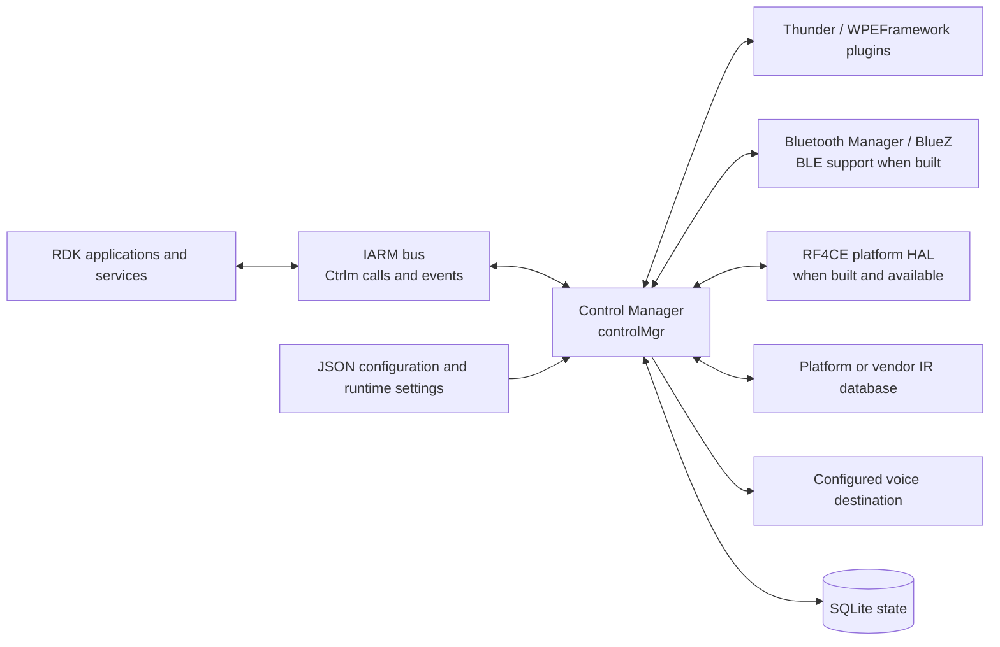
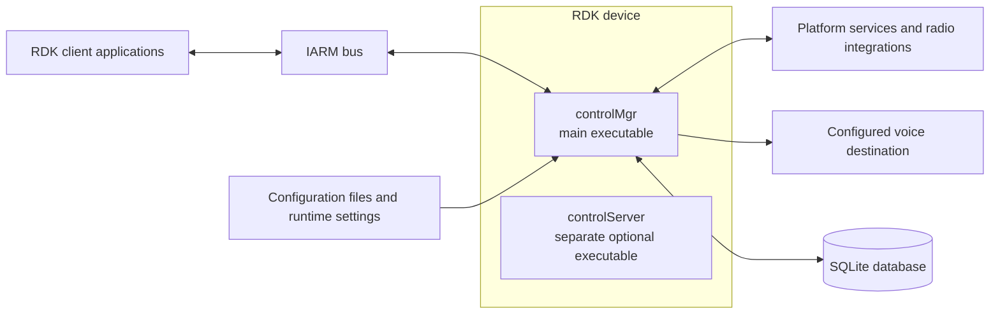
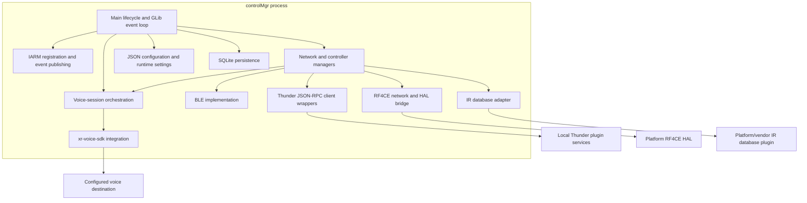

# Control Manager Architecture and Interfaces

Control Manager (`controlMgr`) is a device-side RDK service that coordinates remote-control networks, controller state, voice-session routing, configuration, and related device-control integrations. Its main process is built as the `controlMgr` executable ([CMake target](../CMakeLists.txt), [startup and lifecycle](../src/ctrlm_main.cpp)).

The daemon's primary local client contract is the versioned IARM bus API. Thunder integrations in this repository are JSON-RPC clients of other local platform plugins; they are not the daemon's inbound API. BLE, RF4CE, voice transports, and other integrations depend on build options and target configuration.

## Architecture

The following views describe the same system at context, deployment/container, and component levels. Mermaid flowcharts are used to match the format already present in the [project README](../README.md).

### System context

RDK clients communicate with `controlMgr` through IARM calls and events. The other edges are dependencies used by the daemon: Thunder calls are outbound JSON-RPC, RF4CE is a platform HAL, and voice destinations are selected by configured routes. The diagram is a capability view, not a guarantee that every integration is enabled in every product ([build options](../CMakeLists.txt), [runtime defaults](../src/ctrlm_config_default.json)).

### Containers and deployment units

`controlMgr` is the main executable and runs its lifecycle and event loop in one device process. `controlServer` is a distinct executable included only when `BUILD_CTRLM_SERVER` is enabled; that option defaults to OFF in CMake. It is shown as a separate deployment unit; the diagram makes no claim about a direct communication path between the two executables. Neither source folder names nor linked libraries are separate containers. The exact target image, process supervision, and product feature selection are outside the guarantees of this repository ([root CMake](../CMakeLists.txt), [server target](../src/server/CMakeLists.txt)).

### Main-process components

The main process coordinates network/controller state and exposes IARM handlers. BLE and RF4CE implementations are compile-time gated; RF4CE also depends on a runtime-loadable platform HAL. The IR database adapter loads a platform/vendor implementation when available. Thunder wrappers call local platform plugins, while the voice manager uses `xr-voice-sdk` to route sessions to configured destinations ([source composition](../src/CMakeLists.txt), [main IARM handlers](../src/ctrlm_main_iarm.cpp), [IR database adapter](../src/irdb/ctrlm_irdb_interface.cpp)).

## Data models and persistence

### Configuration

The checked-in [default configuration](../src/ctrlm_config_default.json) is a JSON object with feature sections including `ctrlm_global`, `network_rf4ce`, `network_ble`, `network_ip`, `voice`, and `device_update`. Configuration readers are implemented under [`src/config/`](../src/config/). Relevant examples include:

- `ctrlm_global.db_path` selects the SQLite database file; the checked-in default is `/opt/ctrlm.sql`.
- `network_ble.options`, `network_ble.timeouts`, and `network_ble.models` control BLE-specific options and supported model descriptions. The default model list is empty.
- `voice` contains route URLs such as `url_src_ptt`, `url_src_ff`, and `url_src_mic_tap`; these defaults are empty, so products supply routes when voice destinations are required.

The configuration describes runtime settings; it is not itself a database schema. Build options and product overrides can change the available features and values.

### Runtime and stored state

The public IPC types identify networks and controllers, and network/controller managers own their runtime state ([IPC types](../include/ctrlm_ipc.h), [network manager](../src/ctrlm_network.cpp), [controller manager](../src/ctrlm_controller.cpp)). SQLite stores selected global, voice, IR, network, and controller attributes. The implementation creates tables using `key TEXT PRIMARY KEY, value TEXT` columns and uses dynamically named per-network and per-controller table families; typed helpers also support integer and blob values ([database implementation](../src/database/ctrlm_database.cpp), [database value types](../src/database/ctrlm_db_types.h)).

This is a key/value persistence layout, not a normalized relational model. A controller list associates controller identifiers with a network, while controller-specific records are stored separately. Which network tables exist depends on the networks initialized at runtime. Do not infer that every runtime value is persisted.

## APIs and integrations

### Inbound IARM APIs

`controlMgr` initializes on the IARM bus named `Ctrlm` and registers calls and broadcasts events there ([bus initialization](../src/ctrlm_main.cpp), [main call registration](../src/ctrlm_main_iarm.cpp)). Public calls use C structures declared in the API headers; API revision fields are checked by handlers.

| Contract | Revision | Examples |
| --- | ---: | --- |
| Main Control Manager API ([header](../include/ctrlm_ipc.h)) | 16 | `Main_StatusGet`, network/status queries, audio-capture calls |
| Voice API ([header](../include/ctrlm_ipc_voice.h)) | 9 | `Voice_Status`, `Voice_ConfigureVoice`, `Voice_SessionRequest`, `Voice_SessionTerminate` |
| Remote-control (RCU) API ([header](../include/ctrlm_ipc_rcu.h)) | 13 | `Rcu_ControllerStatus`, RF4CE polling action; controller and key events |

The daemon publishes events for key input, controller status/control, battery/reboot state, firmware progress, and voice sessions. Current voice session/stream notifications use JSON payload events; some older event identifiers in the public header are explicitly marked deprecated. Treat the installed/public headers as the compatibility contract and match the revision required by each API family ([event definitions](../include/ctrlm_ipc.h), [voice call registration](../src/voice/ipc/ctrlm_voice_ipc_iarm_thunder.cpp), [RCU event publication](../src/ctrlm_rcu_iarm.cpp)).

The reviewed main executable does not define an inbound REST endpoint. In particular, the Thunder wrappers below are client integrations, not Thunder APIs served by `controlMgr`.

### Outbound integrations

- **Thunder / WPEFramework**: JSON-RPC client wrappers interact with local services such as PowerManager, DeviceInfo, SystemAudioPlayer, AVInput, HDMI CEC, and DisplaySettings. For example, the PowerManager wrapper calls methods including `getPowerState`; service availability and API definitions belong to the platform plugin ([Thunder clients](../src/thunder/)).
- **BLE**: when built with BLE support, Control Manager uses Bluetooth Manager/BlueZ and the repository's D-Bus/BlueZ implementation ([BLE sources](../src/ble/), [BLE HAL interface](../include/ctrlm_hal_ble.h)).
- **RF4CE**: when built and available, the network uses a platform-provided HAL interface; the main process loads the implementation dynamically ([RF4CE HAL contract](../include/ctrlm_hal_rf4ce.h), [RF4CE network](../src/rf4ce/)).
- **IR database**: an adapter loads a platform/vendor implementation when available and also has a repository stub ([IR database adapter](../src/irdb/ctrlm_irdb_interface.cpp)).
- **Voice destinations**: the voice manager delegates transport/session work to `xr-voice-sdk`; destination routes come from configuration. HTTP and SDT endpoint implementations are conditional CMake features. No fixed remote host or speech-service schema is established here ([voice sources](../src/voice/), [build options](../CMakeLists.txt)).

These integrations are dependencies called or loaded by Control Manager; they are not additional inbound public APIs of the daemon.

## Related documentation and source

- [Repository overview and build guidance](../README.md)
- [Supplementary architecture brief](architecture-brief.md)
- [CMake feature options and install rules](../CMakeLists.txt) and [source composition](../src/CMakeLists.txt)
- [Default JSON configuration](../src/ctrlm_config_default.json) and [configuration implementation](../src/config/)
- [Main, voice, and RCU IARM contracts](../include/ctrlm_ipc.h), [voice contract](../include/ctrlm_ipc_voice.h), and [RCU contract](../include/ctrlm_ipc_rcu.h)
- [BLE and RF4CE HAL contracts](../include/ctrlm_hal_ble.h) and [RF4CE HAL contract](../include/ctrlm_hal_rf4ce.h)
- [Native CI build workflow](../.github/workflows/native_full_build.yml)

The root [README](../README.md) currently describes Thunder `RemoteControl` and `VoiceControl` plugins as the primary public interface. The implementation and public headers reviewed here instead show `controlMgr` exposing IARM calls/events and using Thunder plugins as outbound clients. This page documents the source-backed direction; the root README was left unchanged because this task is limited to `docs/README.md`.
